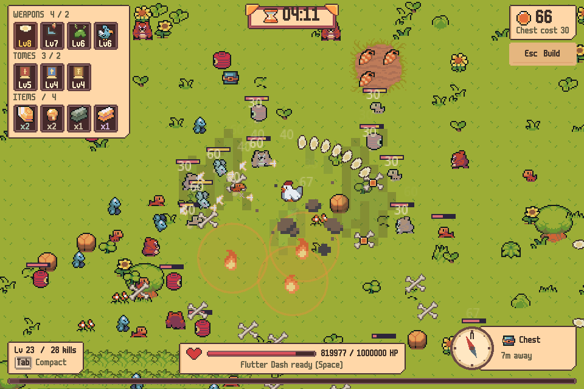
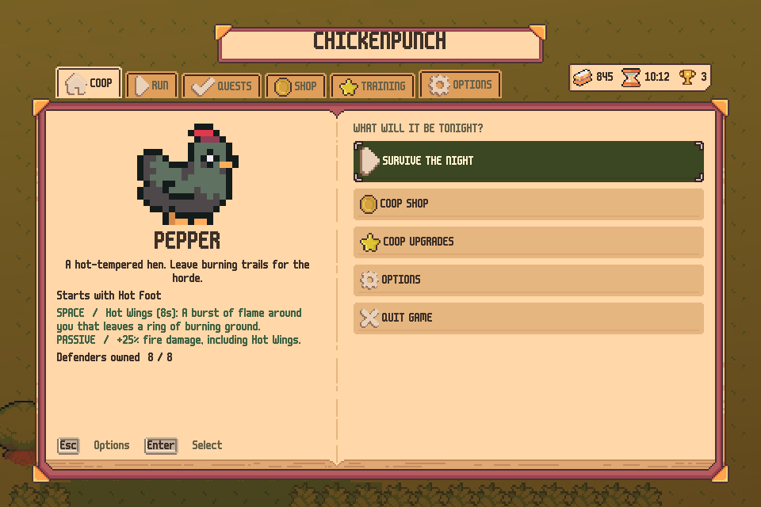
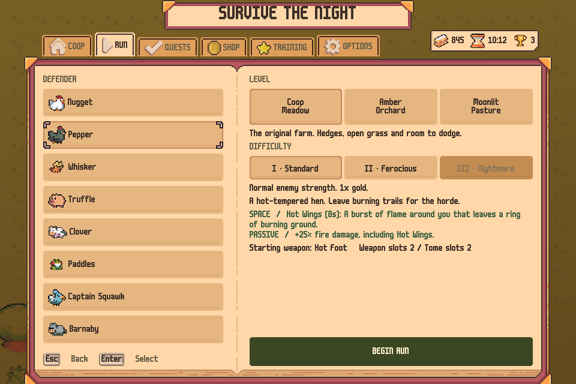
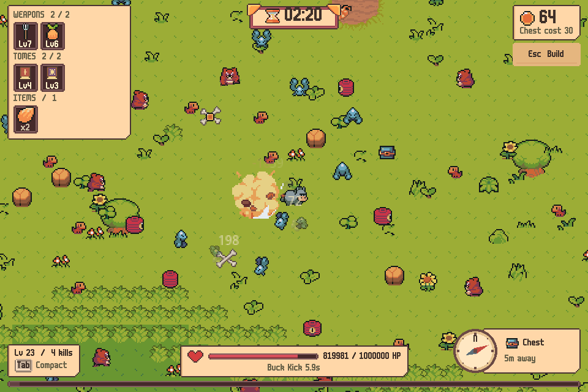
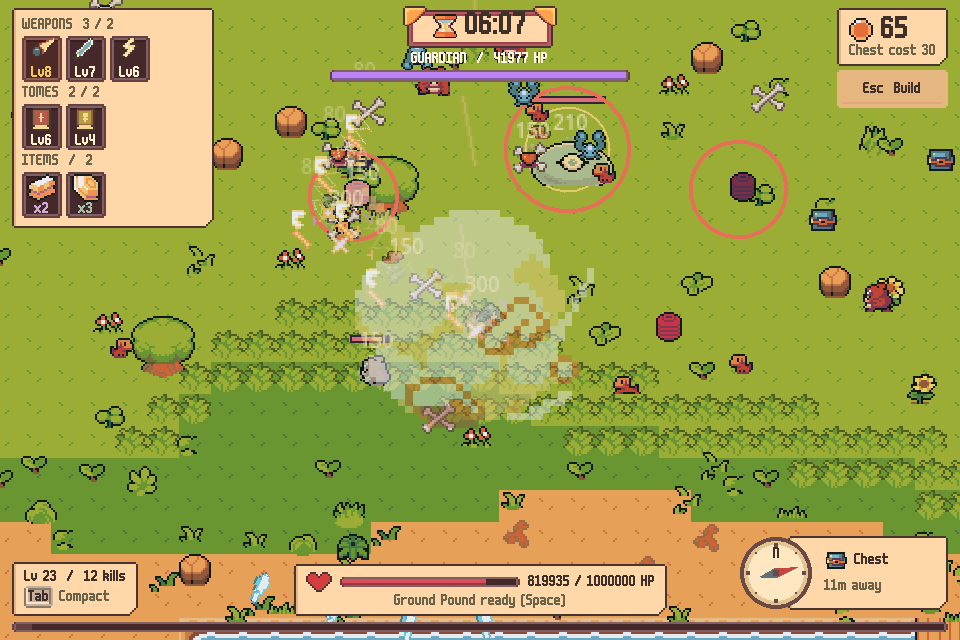
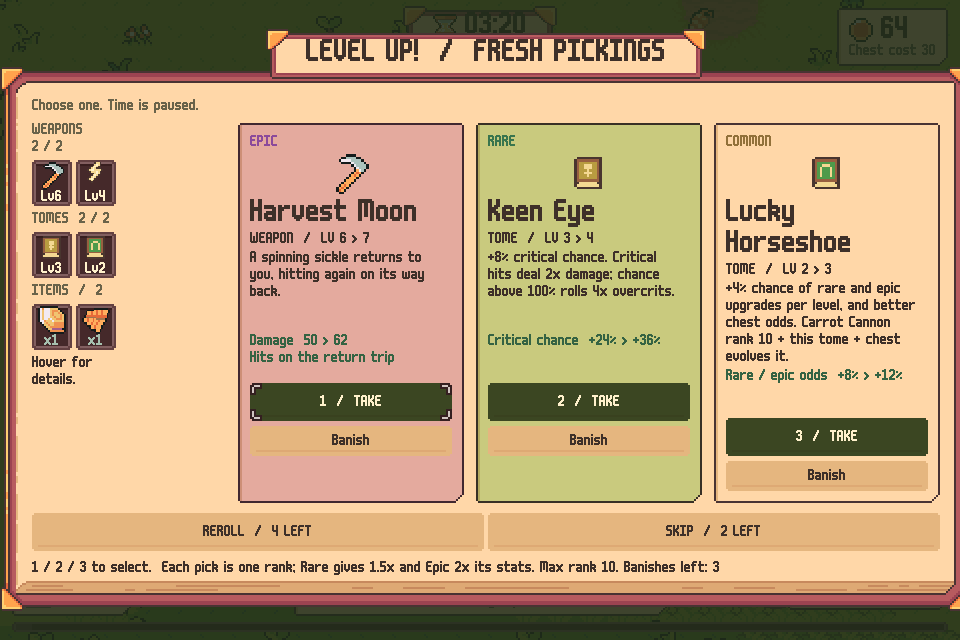
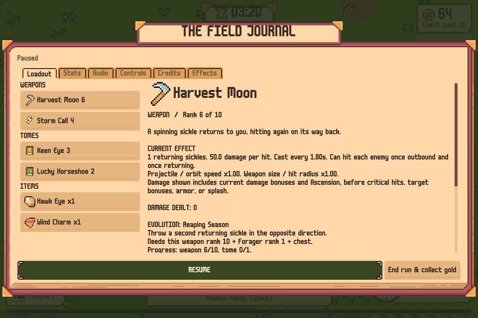
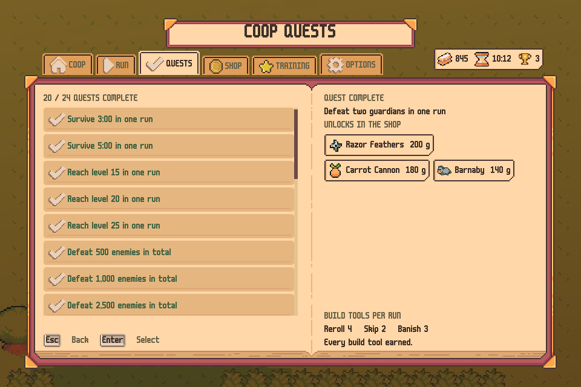
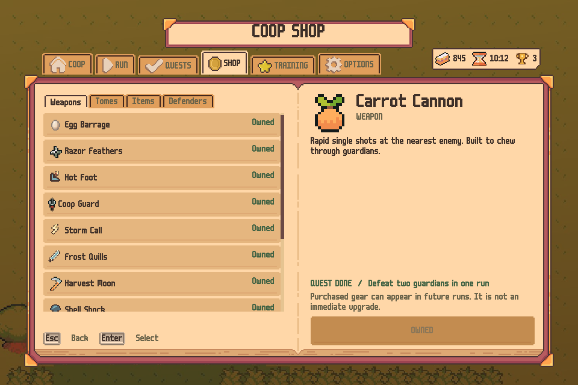
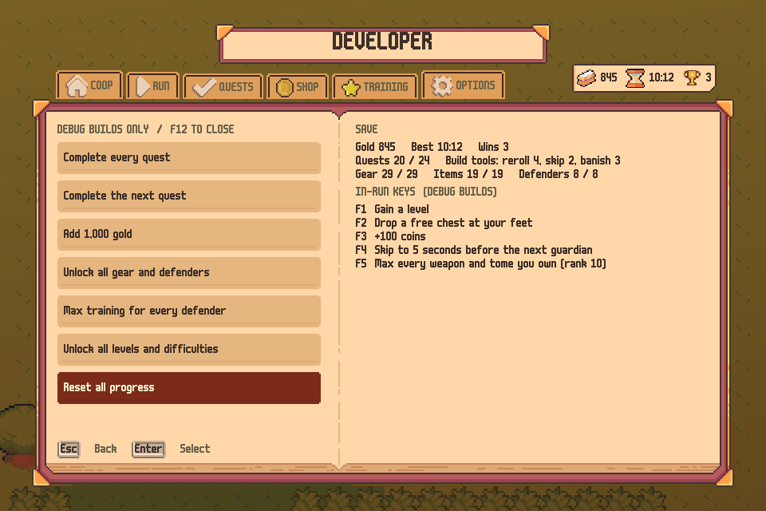

<div align="center">


### Defend the coop until dawn.

A pixel-art **horde-survival** roguelite on a farm under siege —<br>
part *Vampire Survivors*, part *Megabonk*, all chicken.




</div>

---

## Table of contents
- [About](#about)
- [Features](#features)
- [Screenshots](#screenshots)
- [Defenders](#defenders)
- [The arsenal](#the-arsenal)
- [Tomes](#tomes)
- [Items](#items)
- [The horde](#the-horde)
- [Progression: quests, gold and the Coop](#progression-quests-gold-and-the-coop)
- [Controls](#controls)
- [Developer tools (unlock menu)](#developer-tools-unlock-menu)
- [Getting started](#getting-started)
- [Saves & settings](#saves--settings)
- [Project structure](#project-structure)
- [Tests & balance tools](#tests--balance-tools)
- [Credits](#credits)
- [License](#license)

## About

**Chickenpunch** drops you onto a farm at nightfall with one job: keep the coop alive for ten minutes. Dogs, bats, bears and lanterns pour in from every side, and a **guardian** slime arrives at 3:00, 6:00 and 10:00. Your weapons fire on their own. You choose where to stand, when to use your defender's **special ability**, and which upgrade to take at every level-up.

Runs are short and brutal. A new save starts with only the weakest gear, and **winning without unlocking anything is effectively impossible**. Every run advances **quests** (defeat a guardian, reach level 20, open 25 chests), and each finished quest opens a new weapon, tome, item or defender in the Coop Shop. Players who understand the systems can assemble game-breaking builds, but every one of them sits at the end of a long chain of quests and rare items.

## Features

**Core loop**
- **Ten-minute runs** with three guardians and a final boss fight at 10:00.
- **Level up and pick one of three** upgrades. **Rarity makes a pick stronger, not longer**: Common, Rare (1.5x stats) and Epic (2x stats) each add one level, as in Megabonk.
- **12 weapons**, each with an **evolution**: max the weapon, own its tome, open a chest.
- **17 tomes**, **19 stackable items**, **5 synergies** and **3 Ascensions** that transform two evolved weapons at once.
- **8 defenders**, each with a unique **Space ability** (dash, pounce, ground pound, buck kick and more) and a passive.
- **Build tools** earned through quests: rerolls, skips and banishes.
- **Three farms** (Coop Meadow, Amber Orchard, Moonlit Pasture) and **three difficulty tiers** with bigger gold rewards.

**Progression**
- **24 Megabonk-style quests** gate every non-starter weapon, tome, item and defender. Finish the quest, then spend **gold** to unlock it.
- **Coop training** for each defender: damage, health, and extra weapon and tome slots (2 → 4).
- Quest progress comes from lifetime stats, so older saves keep their credit.

**Feel & visuals**
- A **Travel Book** UI: every menu is an open book with a banner title, bookmark tabs and the **m6x11** pixel font, drawn at a crisp 2x.
- **Animated defenders**: a walk bob with a squash on every step and footstep dust, a lean into movement, idle breathing, a stretched dash with a landing squash, and a white flash when hit. Nugget uses the ChickenPack's own jump and damage animations.
- **Animated enemies** walk in four directions and hop, waddle, flutter or float, and pop in when they spawn.
- **Combat feedback** inspired by *Archvale*: directional impact puffs, defeat echoes, dash afterimages, damage numbers, easing health trails and bounded camera kicks.
- **Readable hazards**: each Hot Foot flame sits on a faint fire-coloured ring showing exactly where it burns, and casters and guardians telegraph their volleys.
- **Living farmland**: grass tufts, flowers, bushes and tilled pumpkin patches across every map.
- A reduced-motion option turns every motion effect off.

**Audio**
- **Music that follows the run**: each farm's theme, rising at 3:00 and 6:00, dedicated guardian and final-guardian tracks, and victory and defeat themes, all crossfaded. A calm theme plays on the menus.
- Throttled, pitch-varied combat sounds, with separate music and effects volumes.

## Screenshots

| | |
|:---:|:---:|
|  |  |
| **The Coop: your defender and the main menu** | **Choose a defender, farm and difficulty** |
|  |  |
| **Barnaby's Buck Kick** | **A guardian fight and Truffle's Ground Pound** |
|  |  |
| **Level up: rarity raises a pick's stats** | **The Field Journal: your build in detail** |
|  |  |
| **Quests and the build tools they earn** | **The Coop Shop: quest first, then gold** |

## Defenders

Every defender starts with their own weapon, a **Space ability** and a passive. Abilities scale with your level and damage bonuses, and Wind Charm shortens every cooldown.

| Defender | Starts with | Ability (cooldown) | Passive | Unlock |
|---|---|---|---|---|
| **Nugget** | Egg Barrage | **Flutter Dash** (3s): a quick dash. You are invulnerable for the whole dash, so you can dash straight through the horde. | +10% experience | Starter |
| **Pepper** | Hot Foot | **Hot Wings** (8s): a burst of flame around you that leaves a ring of burning ground. | +25% fire damage, including Hot Wings | Survive 3:00 in one run · 40 gold |
| **Whisker** | Harvest Moon | **Pounce** (6s): leap onto the nearest enemy and strike it. | +10% critical chance | Defeat 1,000 enemies in total · 60 gold |
| **Truffle** | Shell Shock | **Ground Pound** (9s): a shockwave that damages and stuns everything nearby. | +20 max health and +1 armor | Defeat a guardian · 90 gold |
| **Clover** | Coop Guard | **Hold the Line** (14s): 2.5 seconds of invulnerability while your orbiting blades spin and strike twice as fast. | +15% area | Win a run · 120 gold |
| **Paddles** | Stink Cloud | **Leap** (5s): hop clear of danger and splash mud that damages and slows where you land. | +0.5 health regeneration per second | Defeat 2,500 enemies in total · 100 gold |
| **Captain Squawk** | Parrot Squadron | **Squawk** (10s): blast nearby enemies away and stun them briefly. | +25% coins | Open 25 chests in total · 120 gold |
| **Barnaby** | Pitchfork | **Buck Kick** (6s): a huge kick behind you that sends enemies flying. | +30 max health and +10% damage | Defeat two guardians in one run · 140 gold |

## The arsenal

Weapons fire automatically. Raise a weapon to **rank 10**, own its matching tome and open a chest to **evolve** it.

| Weapon | What it does | Evolution (tome) | Unlock |
|---|---|---|---|
| **Egg Barrage** | Another egg every second rank; +4 damage per rank. | **Golden Omelette** (Quick Hatch): three extra eggs per volley, and every hit splashes. | Starter |
| **Hot Foot** | Leaves burning ground behind you. Overlapping flames do not stack. | **Phoenix Trail** (Wide Wings): burning patches 60% larger. | Starter |
| **Harvest Moon** | A spinning sickle that hits again on its way back. | **Reaping Season** (Forager): a second sickle in the opposite direction. | Reach level 15 in one run · 40 gold |
| **Coop Guard** | Orbiting blades guard your personal space. | **Iron Roost** (Iron Shell): two more orbiting blades. | Defeat 1,000 enemies in total · 60 gold |
| **Pitchfork** | Jabs where you face, hitting everything in a narrow line; a second jab at rank 6. | **Devil's Hayfork** (Bramble Coat): two extra jabs around you and 50% longer reach. | Survive 5:00 in one run · 80 gold |
| **Shell Shock** | Explosive shells at the nearest enemy. | **Meteor Nest** (Fighting Spirit): 45% bigger explosions. | Defeat a guardian · 90 gold |
| **Stink Cloud** | A foul aura that damages and slows everything around you. | **Miasma** (Feather Step): half again as wide, 50% slow. | Defeat 2,500 enemies in total · 90 gold |
| **Parrot Squadron** | Homing parrots; another bird every third rank. | **Pirate Flock** (Golden Harvest): two extra parrots, and their kills drop coins. | Open 25 chests in total · 110 gold |
| **Storm Call** | Lightning that chains between enemies from rank 2. | **Thunderhead** (Keen Eye): three more chain targets. | Raise any weapon to rank 10 in one run · 120 gold |
| **Frost Quills** | Piercing ice shards that slow by 45%. | **Deep Winter** (Long Summer): two more shards, 70% slow for 3.5 seconds. | Evolve a weapon · 150 gold |
| **Carrot Cannon** | Rapid single shots built to chew through guardians. | **Golden Carrot** (Lucky Horseshoe): 40% faster, pierces three, +25% crit chance. | Defeat two guardians in one run · 180 gold |
| **Razor Feathers** | Piercing fans of shuriken; more blades per rank. | **Featherstorm** (Fleet Feet): three more blades per fan. | Defeat two guardians in one run · 200 gold |

**Ascensions** need two evolved weapons, both matching tomes at rank 10, three copies of a recipe item and two guardians defeated, then a chest:
- **Absolute Zero**: Storm Call + Frost Quills, Keen Eye + Long Summer, Hawk Eye.
- **Henpocalypse**: Egg Barrage + Hot Foot, Quick Hatch + Wide Wings, Blast Powder.
- **The Last Harvest**: Harvest Moon + Coop Guard, Forager + Iron Shell, Crimson Seed.

**Synergies** switch on automatically: Cold Conductor, Steam Engine, Reaper's Feast, Cluster Nest and Iron Wake. The pause menu's Loadout page explains each one.

## Tomes

Tomes raise a stat for every weapon, and each one also evolves a weapon.

| Tome | Effect | Unlock |
|---|---|---|
| **Big Heart** | +20 maximum health, and heal 20 | Starter |
| **Fleet Feet** | +8% movement speed | Starter |
| **Forager** | +30 pickup radius and +10% XP | Starter |
| **Second Wind** | Recover 0.4 health per second | Starter |
| **Iron Shell** | Reduce each incoming hit by 1 | Defeat 500 enemies in total · 30 gold |
| **Tailwind** | +20% projectile and orbit speed | Open 10 chests in total · 40 gold |
| **Golden Harvest** | +12% coins from pickups | Open 10 chests in total · 40 gold |
| **Bramble Coat** | Enemies that hit you take 8 + 6 per level damage | Defeat 1,000 enemies in total · 50 gold |
| **Long Summer** | +20% duration for fire, slows and other effects | Reach level 20 in one run · 50 gold |
| **Feather Step** | +4% chance to dodge a hit completely (max 40%) | Use your ability 50 times in one run · 60 gold |
| **Wide Wings** | +18% area | Survive 5:00 in one run · 70 gold |
| **Lucky Horseshoe** | +4% rare and epic upgrade odds and better chest odds | Reach level 25 in one run · 70 gold |
| **Fighting Spirit** | +10% damage to every weapon | Defeat a guardian · 80 gold |
| **Quick Hatch** | 5% shorter cooldowns, compounding | Raise any weapon to rank 10 in one run · 100 gold |
| **Giant Hatch** | +20% weapon size, hit radius, explosions and reach | Evolve a weapon · 100 gold |
| **Keen Eye** | +8% critical chance; above 100% rolls 4x overcrits | Win a run · 150 gold |
| **Brood Burst** | One extra shot, blade or chain target per two levels | Win 3 runs · 250 gold |

## Items

Items come from chests, stack up to ten times and never use a slot.

| Item | Rarity | Effect | Unlock |
|---|---|---|---|
| **Wild Honey** | Common | Regenerate 0.3 health per second | Starter |
| **Packed Lunch** | Common | Heal 12 whenever you open a chest | Starter |
| **Iron Bead** | Common | +1 armor | Starter |
| **Oat Sack** | Common | +10 max health | Defeat 500 enemies in total · 25 gold |
| **Coop Key** | Common | A chance to open paid chests for free | Open 10 chests in total · 25 gold |
| **Field Notes** | Common | +12% experience | Reach level 20 in one run · 30 gold |
| **Lodestone** | Common | +25 pickup radius | Defeat 2,500 enemies in total · 30 gold |
| **Lucky Seed** | Common | +6% rare-upgrade chance and better chest loot | Reach level 25 in one run · 35 gold |
| **Moldy Cheese** | Rare | 8% chance to poison on hit (30% of the hit per second, 3 s) | Survive 5:00 in one run · 60 gold |
| **Wind Charm** | Rare | Your ability recharges 15% faster | Use your ability 100 times in one run · 60 gold |
| **Ice Cube** | Rare | 3% chance to freeze an enemy on hit | Evolve a weapon · 70 gold |
| **Crimson Seed** | Rare | Every 15 kills, heal 3 | Defeat 5,000 enemies in total · 80 gold |
| **Red Feather** | Rare | +25% damage below half health | Spend 60 seconds below half health in one run · 90 gold |
| **Hot Sauce** | Rare | +25% critical damage, multiplied per overcrit tier | Raise Keen Eye to rank 10 in one run · 100 gold |
| **Hawk Eye** | Rare | +8% critical chance | Raise Keen Eye to rank 10 in one run · 120 gold |
| **Blast Powder** | Epic | Every 8th kill explodes | Evolve Hot Foot into Phoenix Trail · 150 gold |
| **Giant Slayer** | Epic | +20% damage to elites and guardians | Defeat 6 guardians in total · 150 gold |
| **Rusty Anvil** | Epic | Weapon level-ups gain +25% more stats | Win 3 runs · 160 gold |
| **Big Bonk Mallet** | Epic | 2% chance for a hit to deal 20x damage | Win a run on Ferocious or harder · 180 gold |

Effects are per stack.

## The horde

| Enemy | Behaviour |
|---|---|
| **Dog** | A fast, relentless chaser |
| **Blue bat** | Very fast and fragile; arrives after 0:35 |
| **Bear** | Slow and tanky, hits hard; arrives after 1:30 |
| **Red lantern** | Keeps its distance and fires telegraphed volleys; arrives after 2:30 |
| **Elite** (gold ring) | Five times the health; drops a free chest |
| **Giant Slime guardian** | At 3:00, 6:00 and 10:00: rotating bullet rings and aimed volleys. Defeat the last one to win. |

Enemy health and damage grow throughout a run. Amber Orchard and Moonlit Pasture send faster waves, and difficulty tiers II and III add enemy strength and gold.

## Progression: quests, gold and the Coop

1. **Play runs.** Gold pays out for survival time, kills, guardians and wins.
2. **Finish quests** on the **Quests** tab. Each one opens gear or a defender in the **Coop Shop**, and every few completed quests add a reroll, skip or banish to every run.
3. **Buy access** in the shop. Purchases add gear to future level-up and chest pools; they are not instant upgrades.
4. **Train** each defender in **Coop Upgrades**: damage, health and extra slots.

A new save starts with Egg Barrage, Hot Foot, Big Heart, Fleet Feet, Forager, Second Wind, Wild Honey, Packed Lunch and Iron Bead. The full quest table is in [docs/design/PROGRESSION_REBALANCE.md](docs/design/PROGRESSION_REBALANCE.md).

## Controls

| Action | Keyboard |
|---|---|
| Move | `W` `A` `S` `D` or arrow keys |
| Defender ability | `Space` |
| Open a nearby chest | `E` |
| Pick an upgrade | Click a card or press `1` / `2` / `3` |
| Pause / Field Journal | `Esc` |
| Compact / full HUD | `Tab` |
| Mute | `M` |

In **Options**, each switch shows its state: a **lit** switch and the word **ON** mean the setting is active.

## Developer tools (unlock menu)

For testing, **debug builds** include a hidden developer menu. A debug build is the game running from the Godot editor (press `F5` in the editor), or a build exported with **Export With Debug** ticked. Release exports (`--export-release`) leave all of this out, so players never see it.

**On the main menu, press `F12`** to open the **Developer** page. Press `F12` again to close it.

| Button | What it does |
|---|---|
| Complete every quest | Finishes every quest, which also grants every reroll, skip and banish |
| Complete the next quest | Finishes one quest, to step through unlocks in order |
| Add 1,000 gold | Adds permanent gold |
| Unlock all gear and defenders | Owns every weapon, tome, item and defender |
| Max training for every defender | Damage 5, health 5, 4 weapon slots and 4 tome slots |
| Unlock all levels and difficulties | Every farm and every tier |
| Reset all progress | Wipes the save but keeps audio settings; click twice to confirm |

**During a run** (debug builds only):

| Key | Effect |
|---|---|
| `F1` | Gain a level |
| `F2` | Drop a free chest at your feet |
| `F3` | +100 coins |
| `F4` | Skip to 5 seconds before the next guardian |
| `F5` | Raise every weapon and tome you own to rank 10 |

**Quick way to try new content:** press `F12`, click **Unlock all gear and defenders** and **Max training**, then start a run. Press `F5` to max your gear, then `F2` a few times to open chests and evolve weapons.



## Getting started

### Requirements
- [Godot Engine **4.7**](https://godotengine.org/download), standard build (no C#/.NET needed)
- Any GPU that runs the Compatibility (OpenGL) renderer; the Web build runs in modern browsers

### Run from source
```bash
git clone https://github.com/AmitShok/chicken-punch.git
```
1. Open Godot 4.7 and **Import** the cloned folder's `project.godot`.
2. Let the first import finish (it builds the `.godot/` cache).
3. Press **F5** to play from the main menu.

### Build a standalone game
Windows and Web export presets are included. Install the 4.7 export templates, then see [docs/release/EXPORTS.md](docs/release/EXPORTS.md):
```bash
godot --headless --path . --export-release "Windows Desktop"
```

## Saves & settings

- **Windows:** `%APPDATA%\Godot\app_userdata\Chickenpunch\coop_save.cfg`
- **Web:** the browser's local storage, written immediately so a refresh never loses a purchase

The save holds gold, unlocks, quest stats, training, records and options (music and effects volume, mute, reduced motion). Tests and capture tools use their own save files and never touch yours.

## Project structure

| Folder | Contents |
|---|---|
| `scenes/` | Main menu, world, player and enemy scenes |
| `scripts/survival/` | Run director, arsenal, abilities, HUD and menus (`interface.gd`), inspection text, data and quests |
| `scripts/data/` | Resource classes for weapons, tomes, items, defenders and the catalog |
| `resources/catalog/` | All content as editable `.tres` files; see [Adding content](docs/design/CONTENT_GUIDE.md) |
| `scripts/actors/` | Player and enemy behaviour and animation |
| `scripts/ui/` | Main menu and Travel Book drawing |
| `scripts/world/` | Ground decoration and spawning |
| `assets/` | Asset packs, fonts, Travel Book UI and custom Coop art (with `.aseprite` sources) |
| `tests/` | Automated gameplay and regression tests |
| `tools/` | Balance simulator, capture scripts and Aseprite art generators |
| `docs/` | Design notes, release instructions, logo and screenshots |

## Tests & balance tools

Run any test headlessly, replacing `godot` with your Godot executable:
```bash
godot --headless --path . --script res://tests/content_test.gd
```
`tests/` holds suites for combat, progression, quests, content, menus, settings, animation, music, maps and the developer tools.

Balance tools in `tools/balance/`:
- `sim_run.gd` plays full runs with a kiting bot, on a fresh or veteran save with any defender.
- `weapon_bench.gd` measures each weapon's damage per second against a crowd and a single target.
- `boss_race.gd` times how fast named builds kill each guardian.

`tools/capture/capture_readme.gd` regenerates this README's logo and screenshots:
```bash
godot --path . --script res://tools/capture/capture_readme.gd
```

## Credits

**Chickenpunch** is made by **Floor 38 Studio**.

Third-party assets:
- **Ninja Adventure Asset Pack**: tiles, monsters, animals, items, effects, music and sounds, by [Pixel-boy & AAA](https://pixel-boy.itch.io/ninja-adventure-asset-pack) (CC0)
- **ChickenPack**: the original chicken and its animations (royalty-free; not for resale)
- **Travel Book Lite** UI, by [Crusenho Agus Hennihuno](https://crusenho.itch.io/complete-ui-book-styles-pack)
- **m6x11** pixel font, by [Daniel Linssen](https://managore.itch.io/m6x11) (free with attribution)
- Built with the [Godot Engine](https://godotengine.org)

Design inspiration: *Vampire Survivors*, *Megabonk*, *Brotato* and *Archvale*. Design notes and research sources are in [docs/design/](docs/design/).

## License

No open-source license has been chosen yet, so all rights to the original code and art are reserved by **Floor 38 Studio**. Third-party assets remain under their creators' licenses; see each pack's `License.txt`.
